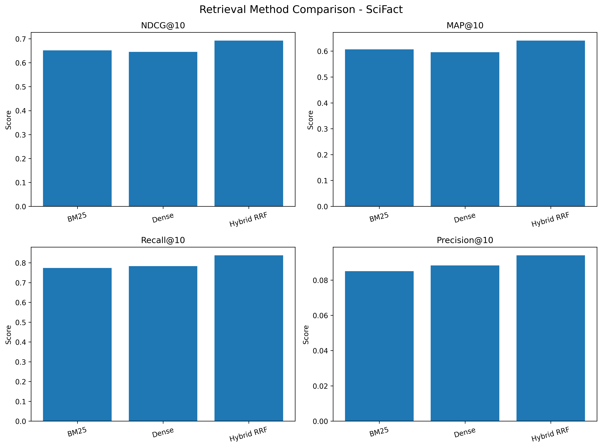
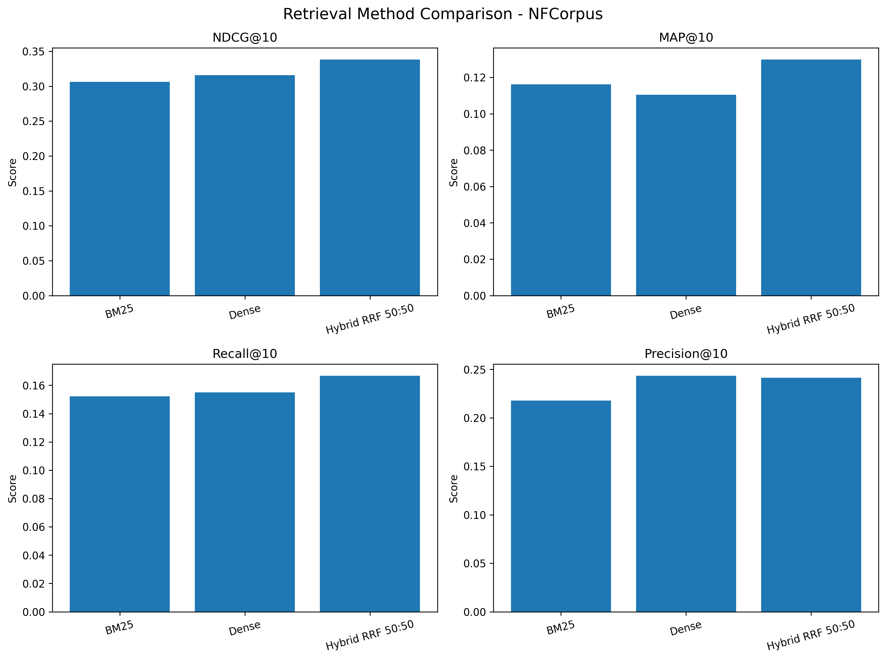

# Comparative Evaluation of Keyword, Semantic, and Hybrid Retrieval Strategies for RAG Systems

An independent benchmark-based experimental study comparing lexical, semantic, and hybrid document retrieval approaches using BEIR datasets.

## Research Overview

Retrieval-Augmented Generation (RAG) systems depend on retrieving relevant information before generating answers. This project investigates whether combining keyword-based and semantic retrieval improves document retrieval quality.

**Research Question:** Does combining BM25 and dense semantic retrieval improve retrieval performance compared with using either method independently?

## Research Objectives

- Implement keyword-based retrieval using BM25.
- Implement semantic retrieval using Sentence Transformers.
- Develop a hybrid retrieval approach using Reciprocal Rank Fusion (RRF).
- Evaluate retrieval performance using standard information retrieval metrics.
- Compare results across two BEIR benchmark datasets.

## Retrieval Methods

| Method | Description |
|---|---|
| BM25 | Keyword-based lexical retrieval |
| Dense Retrieval | Semantic search using sentence embeddings |
| Hybrid RRF | Combines BM25 and dense rankings using Reciprocal Rank Fusion |

## Datasets

Experiments were conducted using two BEIR benchmark datasets:

1. **SciFact:** Scientific claim verification retrieval dataset.
2. **NFCorpus:** Biomedical and nutrition-related information retrieval dataset.

## Technology Stack

- **Programming Language:** Python
- **Environment:** Google Colab
- **Libraries:** BEIR, Rank-BM25, Sentence Transformers, FAISS, NumPy, Pandas, Matplotlib
- **Embedding Model:** all-MiniLM-L6-v2
- **Ranking Technique:** Reciprocal Rank Fusion (RRF)

## Evaluation Metrics

- NDCG@10
- MAP@10
- Recall@10
- Precision@10

## Experimental Results

### 1. SciFact Results

| Method | NDCG@10 | MAP@10 | Recall@10 | Precision@10 |
|---|---:|---:|---:|---:|
| BM25 | 0.65189 | 0.60697 | 0.77400 | 0.08500 |
| Dense | 0.64508 | 0.59593 | 0.78333 | 0.08833 |
| Hybrid RRF | **0.69217** | **0.64052** | **0.83767** | **0.09400** |

**Observation:** Hybrid RRF achieved the highest scores across all four reported metrics on SciFact.



### 2. NFCorpus Results

| Method | NDCG@10 | MAP@10 | Recall@10 | Precision@10 |
|---|---:|---:|---:|---:|
| BM25 | 0.3061 | 0.1162 | 0.1521 | 0.2180 |
| Dense | 0.3159 | 0.1105 | 0.1550 | **0.2433** |
| Hybrid RRF | **0.3381** | ~0.1298* | **0.1667** | 0.2415 |

**Observation:** Hybrid RRF achieved the highest reported NDCG@10 and Recall@10. Dense retrieval achieved the highest Precision@10.



*Note: The NFCorpus Hybrid MAP@10 value is approximate and must be verified against the original CSV before formal submission.*

## Weighted RRF Experiment

Three BM25 and dense retrieval weight combinations were explored on SciFact.

| BM25 Weight | Dense Weight | NDCG@10 | MAP@10 |
|---:|---:|---:|---:|
| 0.25 | 0.75 | 0.66160 | 0.61689 |
| 0.50 | 0.50 | **0.69217** | 0.64052 |
| 0.75 | 0.25 | 0.67985 | **0.64310** |

The 50:50 configuration achieved the highest NDCG@10 among the tested configurations, while 75:25 achieved the highest MAP@10.

## Key Findings

- Hybrid retrieval performed strongly across both benchmark datasets.
- Hybrid RRF achieved the highest NDCG@10 and Recall@10 on both datasets.
- Dense retrieval achieved the highest Precision@10 on NFCorpus.
- The best retrieval configuration can depend on the evaluation metric and dataset.

## Repository Structure

```text
rag-retrieval-research/
│
├── RAG_Retrieval_Research.ipynb
├── README.md
├── requirements.txt
├── LICENSE
├── retrieval_comparison (1).csv
├── weight_experiments (1).csv
├── nfcorpus_retrieval_comparison.csv
├── scifact_comparison.png
├── nfcorpus_comparison.png
└── RAG_Retrieval_Research_Report.pdf
```

*The PDF and CSV filenames in this structure should match the actual names in the repository.*

## How to Run

1. Clone the repository:

```bash
git clone https://github.com/KHarshithaaa/rag-retrieval-research.git
```

2. Navigate to the project directory:

```bash
cd rag-retrieval-research
```

3. Install the required libraries:

```bash
pip install -r requirements.txt
```

4. Open the Jupyter Notebook in Google Colab or a local Jupyter environment.

5. Run the notebook cells to reproduce the retrieval experiments.

## Limitations and Future Work

- The experiments cover only two BEIR datasets.
- Only one dense embedding model was evaluated.
- The SciFact test split was also used for exploratory weight selection.
- The NFCorpus Hybrid MAP@10 value requires verification.
- The study evaluates retrieval performance, not complete RAG answer generation or factuality.
- Statistical significance testing and per-query error analysis have not yet been performed.

Future work includes evaluating additional embedding models, using separate validation and test splits, testing reranking methods, and evaluating a complete RAG pipeline.

## Research Status

This is an independent preliminary experimental research project. The findings are exploratory and do not represent peer-reviewed or published research.

## Author

**Kothagundla Harshitha**

B.Tech Computer Science and Engineering  
KL University

- GitHub: [KHarshithaaa](https://github.com/KHarshithaaa)
